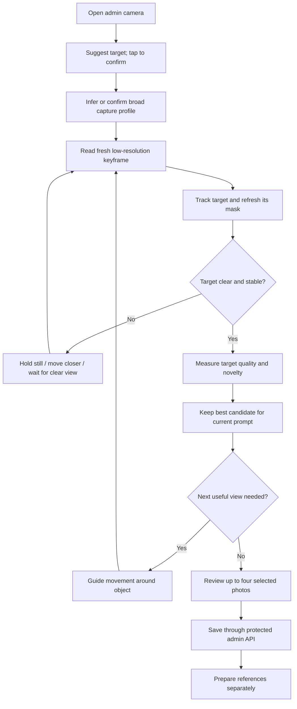

# Guided reference capture: requirement, solution and feasibility tests

Date: 2026-11-05. Branch: `feat/guided-reference-capture`.

Design-stage status (superseded by the local implementation in
[doc 28](28-guided-capture-implementation.md)): guided camera and segmentation were
not implemented when the offline selection spike below was written. Existing
admin/visitor behavior, reference sets and live deployment were unchanged at that
design stage. Implementation and release details are in doc 28.

## Goal and scope

An administrator opens the camera, selects the target object, and moves around it
while the application gives simple guidance. The application selects clear,
usefully different frames and offers up to four photos for review and saving.
The required output is a reliable reference-photo set that supports later visitor
recognition of the same object across most intended, observable viewing scenarios.
Visual attractiveness, sharpness alone and reaching a photo count are insufficient.
Visitor knowledge generation, narration, general 3D reconstruction and a new
recognition model are outside this change.

This is an explicit administrator-capture extension to the historical online-only
photo-acquisition constraint in docs/11 and docs/13. It does not ask ordinary
visitors to collect validation data. A capture session's selected references must
not also be counted as independent accuracy-test photographs.

## Output requirement: references that work during later visits

Deliver a set of genuine, correctly associated object photos with complementary
coverage, preserved source hashes and any crop/mask derivatives linked explicitly.
Keep acquisition quality, view coverage and measured recognition readiness as
separate states. A successful capture is not automatically a validated reference set.

"Most scenarios" means the agreed visitor-condition matrix: accessible viewing
angles, ordinary distance/framing changes, expected venue lighting, informative
partial views, modest handheld movement, changing backgrounds and nearby people.
Test similar objects and unsupported objects as competing/negative cases. Report
each condition and object type separately so a high overall average cannot hide
failure from a common viewing position. Distinguish insufficient visible evidence
from a wrong identification; unknown/ambiguous views should permit abstention.

Validation uses separately captured visitor-style photos or phone sessions after
references and decision settings are frozen. Apply the existing recognition gates,
including correct-suggestion coverage, precision, false suggestions and latency.
Do not use the admin sweep itself, its crops or adjacent frames as the independent
evidence that the chosen photos will work during a later visit.

The output includes the selected photos, observed coverage and remaining gaps.
When a common intended scenario fails, ask for the missing genuine view or revise
the recognition pipeline and rerun validation. Save incomplete sets as drafts
without claiming they are ready. The current four-photo software limit is a
baseline constraint, not permission to weaken this reliability requirement; if
four views are inadequate, evaluate additional active views and their runtime cost.

## Requirement interpretation

| Request | Proposed behavior |
|---|---|
| Receive camera frames | A live preview with throttled analysis of fresh frames; no continuous video recording or upload |
| Find the object | Suggest the centered target; let the administrator tap to select/correct it before collecting references |
| Choose the best frames | Gate target visibility/quality, remove near duplicates, retain the best frame for each requested view |
| Guide different angles | A short capture plan based on a broad object profile; verify useful appearance change without claiming exact camera pose |
| Remove background noise | Use a target crop and optional segmentation mask as derived assets; exclude visible background without altering the object's pixels |
| Background people | Exclude people outside the target mask; wait/reacquire when a person obscures the target |
| Another AI API | Optional, bounded administrator-only analysis through our backend; no provider key in the browser and no call per video frame |

Turning a phone in place is not the same as seeing another side of an object.
For a 3D object the guidance says to **move around the object while keeping it in
view**, where access allows. A painting asks for small changes in viewing position,
not a back view. The UI must never ask someone to cross a barrier or move an exhibit.

## Recommended solution

Use a browser-first capture/quality loop, target-seeded segmentation on selected
keyframes, and the existing protected upload/publication workflow. Add a narrowly
scoped external model only if local segmentation or type inference fails its
benchmark. Do not put a heavy video model into the current visitor inference
process or introduce queues, microservices or new canonical collections now.



### User flow

1. The admin chooses a venue and taps Add object, then Guided capture. Existing
   gallery upload and single-photo capture remain available.
2. The preview suggests an object around the aiming point. If several objects are
   visible, collection waits for a tap; the system does not silently choose the
   largest person or foreground object. Show an outline before accepting a frame.
3. Infer a broad capture profile, with an unobtrusive correction control:
   flat artwork, 3D object, or large fixed scene. Unknown results request that one
   choice. Do not infer a canonical object identity from this classification.
4. Give one instruction at a time: Center the object; Hold still; Move a little to
   the left; Keep the whole object visible; Wait for a clear view. Use progress
   thumbnails, not a quality percentage or an unsupported angle-complete badge.
5. Stop when the proposed reference set is ready or the admin taps Finish. Show
   selected source photos with the target outline, suggested crop, and any gaps.
   Allow retake, replacement, crop/mask correction and removal before Save.
6. Save the chosen photos only. Keep source/reference preparation a separate
   explicit action, as today. An incomplete set can be saved truthfully; neither
   four images nor a green progress indicator establishes recognition accuracy.

No creator, photographer-name or permission-detail form is reintroduced. The
object-name requirement and existing reference association remain. Suggested
object profile/view labels are editable metadata, not authoritative evidence.

### Capture plans

| Profile | Initial requested views | Notes |
|---|---|---|
| Flat artwork | Frontal full view, modest left and right obliques | A fourth slot targets a real lighting/detail gap; preserve a full-object anchor |
| Front-only 3D display | Front, front-left, front-right, optional elevated view | Do not waste slots on inaccessible rear views |
| Walk-around object | Four representative accessible sides | Guidance suggests a circuit; intermediate angles and full 360-degree coverage remain unproven |
| Building/large scene | Main approach and accessible oblique views | Do not promise to remove the entire scene's background; the scene may be the target |

The four-view active limit remains unchanged. A future comparison of four versus
eight genuine views is a separate reference/runtime experiment. Within a session,
prompt labels such as `left-step` mean the requested capture stage; they are not
measured azimuth angles. IMU rotation and image dissimilarity alone cannot certify
that the user has seen the back of the same object.

## Frame processing and selection

Proposed initial engineering bounds, to be tuned on development data:

- Keep the video preview responsive independently of analysis. Sample fresh frames
  at roughly 2-5 Hz for cheap measurements, with segmentation initially capped at
  1-2 keyframes/second. These are workload targets, not measured phone throughput.
- Use `requestVideoFrameCallback` when available; fall back to a timer plus
  `video.currentTime` checks. Never analyze the same decoded frame repeatedly.
- Analyze a 512-640-pixel image in a worker. Retain higher-resolution candidates
  only when they improve the shortlist. Do not derive saved references from the
  visitor scanner's existing fixed 224-pixel center crop.
- Keep at most two optimized JPEG candidates for each of four prompts, eight
  candidates total, with explicit byte/dimension bounds. Retain at most four final
  selected photos. Revoke displaced Blob URLs promptly and do not retain an entire
  ImageData/video sequence.
- Permit one analysis request in flight. Drop intermediate frames rather than
  queueing stale work. Use capture-session ID, target version, request sequence and
  object/venue context to discard late responses after Stop, retarget or navigation.
- Stop camera tracks and clear transient frames on Cancel, background/page exit,
  logout or session invalidation. Do not resume camera access automatically.

Evaluate in this order:

1. **Target continuity:** is this still the chosen object? Ambiguity freezes capture
   and asks for reacquisition. An embedding score is supporting evidence, not an
   identity probability. A genuine side change must not be rejected solely because
   its appearance differs from the front.
2. **Visibility:** reject a clipped silhouette, small target, invalid mask or known
   occlusion. A person-detector hit alone is insufficient: a statue or a figure in
   a painting can look like a person. Validate overlaps against the selected target
   and prompt for confirmation when uncertain.
3. **Target quality:** measure focus/blur inside an eroded visible-target mask,
   exposure clipping, target pixel area, motion and framing. Sharp clothing or
   textured walls outside the object must not make a blurred target acceptable.
   Normalize the working scale before comparing sharpness scores.
4. **Novelty:** compare target-focused perceptual hashes and, where justified,
   local matches/embeddings. Different compression or moving background people do
   not create another view. Novelty cannot prove viewpoint or identity.
5. **Selection:** improve the current prompt's candidate only if target quality
   improves. Preserve a clear anchor and favor useful view coverage over choosing
   four highest-sharpness near-duplicate front frames.

Thresholds must be calibrated by object type, working resolution and device.
Laplacian sharpness can be high for sensor noise and low for a valid smooth
surface. It is one signal; the spike's numerical gates must not be shipped as
production acceptance criteria.

## Background removal: useful, with strict limits

Use segmentation to identify existing visible object pixels. Prefer a tight,
aspect-preserving crop first. Store an optional mask and normalized derivative
separately from the selected source photograph, with the transformation recorded.
Use transparent or neutral padding only for a tested descriptor variant.

Do not use generative erase/inpainting, synthetic side views, enhancement that
invents texture, or an AI-redrawn object as recognition evidence. A person in the
background can be masked out; a person covering the object requires a later clear
frame or a different real viewing position. Thin sculpture limbs, transparent
surfaces, glass cases, shadows and reflections are explicit failure cases to test.

The selected source frame stays private under the current admin photo policy;
unselected frames/video are discarded. A mask is a derivative linked to the source,
not a new independent capture or canonical factual source. A background-cropped
derivative can reduce distractions but must not silently overwrite the source.

Masking references alone can introduce a mismatch with unmasked visitor queries.
Compare current full-frame references, target crops, and masked derivatives with
the same independent query set. Record a new preprocessing identity if a descriptor
path changes; do not silently mix incompatible stored embeddings or replace all
working references without a measured benefit.

## Technology assessment

| Option | Fit and limitation | Proposed use |
|---|---|---|
| Existing OpenCV region proposals | Cheap edges/contrast; neither semantic detection nor a reliable target mask | Baseline/fallback only |
| MediaPipe interactive segmentation | Browser-capable, selected-object masks; current documented API operates on pinned still images, not a video tracker | First candidate to benchmark on sampled keyframes in an admin worker, with local tracking between updates |
| SAM 2.1 | Promptable image/video segmentation and streaming memory; published setup targets GPU use | Controlled segmentation-quality benchmark; hosted sparse-keyframe option if browser masks fail |
| SAM 3/3.1 | Text/visual-prompt detection, segmentation and tracking; documented CUDA prerequisites, checkpoint access and a distinct SAM License | Strong comparison candidate, not a dependency added to the existing one-CPU service |
| Multimodal external API, e.g. Gemini image understanding | Can suggest broad type/boxes or segmentation; response format/support varies by pinned model | Optional low-frequency bootstrap/recovery, never sole proof of exact identity or angle |

Recommendation: prototype **tap-to-lock + browser quality selection + sampled
interactive masks** first, because the current hosting is one CPU/2 GiB and visitor
recognition already has shared-capacity limits. The tap is a reliable correction
path for arbitrary artifacts outside ordinary detector class lists. It is not a
requirement to hand-select every frame. Model/worker performance and mask quality on
iPhone 12 Pro remain open gates; documentation does not establish them.

If the browser candidate fails, compare a bounded hosted SAM-family service on
preselected keyframes. Do not select a vendor based solely on a demo. Measure
latency, exact target retention, mask errors, download/runtime memory, per-session
cost, cancellation, retention settings and exact model/runtime licensing.

No external AI call or new model download was made in this analysis. Provider
selection, current pricing and credential setup are still required before an
external-model trial. Never send the admin token to that provider.

### Optional API budget and boundary

For an external trial, start with one bootstrap call and at most one recovery
call per prompted view, capped at five calls/session. Treat this as a trial budget,
not a throughput promise. Do not send continuous video or the entire frame buffer.
Upload only explicitly analyzed stills through an authenticated VisitAdvisor
endpoint with server-side call/byte/time limits. The browser count is not a trusted
cost control. Stop further requests when the quota is exhausted; keep manual
capture available without silently changing providers or widening the budget.

A possible endpoint is `POST /api/v1/admin/capture/analyze`, accepting a bounded
JPEG, point/box prompt, session/request IDs and a closed-set profile hint. Return
validated normalized coordinates, model/version, suggested profile and mask status.
Reject malformed/out-of-frame masks, invalid profiles and stale response context.
Do not expose arbitrary remote-image URLs or proxy arbitrary prompts. Reuse the
existing admin authentication and upload-size handling. Existing public catalog
write protection is a separate known issue; do not copy that gap into this route.

For the browser-first implementation, session state stays in memory; no new
database collection, server-side video session or durable job is needed.

## Source provenance and integration

Keep existing object/source IDs and private upload records. Proposed optional
capture metadata is a small validated subdocument: session/frame IDs, requested
prompt, timestamps, normalized target box, quality measurements, profile origin,
original image hash and any mask/crop hash plus model/transform version.

`requested_view` is separate from a user-confirmed or measured `viewpoint`.
An inferred label must not falsely satisfy the current two-distinct-view readiness
check. Record uncertainty and missing coverage. AI output must not assign official
identity, attribution, rights status or source evidence.

Use `admin_reference_photos.data` for the selected metadata-stripped source JPEG;
link bounded mask/crop derivatives explicitly if persisted. Validate mask dimensions
and decoded size before storage. Reuse existing per-object photo limits and duplicate
hash checks. Reference publication remains the existing separate operation.

Planned touch points: admin HTML/JS plus a capture worker/module; bounded admin
analysis route only if server assistance is selected; optional upload metadata;
source-linked descriptor preparation only after an ablation demonstrates benefit.
No change to the visitor `/live/recognize` contract in the first implementation.

## Feasibility tests performed

The new `scripts/guided_capture_spike.py` is a deterministic offline probe for
target-quality measurement, perceptual duplicate filtering and bounded selection.
Its target boxes/masks and continuity/occlusion flags are **supplied by fixtures**.
It does not detect an object, run a segmenter, estimate pose, recognize a person,
access a camera or call a provider. The script is not imported by the application.

The accompanying tests cover:

- Blurry target with a sharp background: target quality rejects the bad capture.
- Better frame replacement within one prompt, preserving the better previous frame.
- Re-labelled exact duplicates and JPEG recompression failing to add a new view.
- Background-only changes failing to establish target novelty.
- Supplied occlusion/target-loss signals preventing acceptance.
- Tiny targets, heavy clipping, empty masks and invalid mask/box coordinates.
- A supplied mask excluding sharp distractors inside a larger target box.
- At most four requested prompts and rejection of unknown prompts.

Recorded local results are in
[guided-capture-spike-2026-11-05.json](guided-capture-spike-2026-11-05.json).
The blurry-target/sharp-background fixture has whole-frame sharpness about 4078
but target sharpness about 1.26, correctly producing `hold_steady`. The clear target
measures about 9989 and is accepted. These values are implementation-specific.
An existing single Milkmaid image scores about 760 versus 7.33 for a blurred
diagnostic derivative. It is historical data, not a new independent query.

On this Windows development host, target-quality measurement alone took about
1.70 ms median and 2.02 ms p95 over 50 iterations. This excludes detection,
segmentation, camera acquisition, JPEG upload, mobile hardware and network latency.
It must not be advertised as end-to-end performance or an accuracy improvement.

Reproduce with existing camera-server extras:

```powershell
python -m pytest tests/test_guided_capture_spike.py -q
python -m scripts.guided_capture_spike
python -m scripts.guided_capture_spike --output .local/new-capture-spike.json
```

An output path must not already exist. Outputs contain numeric measurements and
hashes, not photo derivatives. Synthetic blur/noise are controlled diagnostics;
they must not be counted as independent reference/evaluation photographs.

## Implementation sequence and acceptance gates

1. **Capture lifecycle:** preview, tap-to-lock, bounded candidates, profile-guided
   prompts and review/save. Test permission denial, Stop, backgrounding, logout,
   venue changes, upload retry and late responses. Keep existing gallery fallback.
2. **Selection:** target-scoped quality and duplicate checks with unknown states.
   Add mobile worker timing and quality labels from actual captures; calibrate gates.
3. **Segmentation trial:** test browser masks against labeled real frames; compare
   hosted models only if needed. Use original/crop/mask review side by side. Human
   target correction stays available. Do not treat a successful mask as identity.
4. **Recognition ablation:** freeze full-frame, crop and mask variants; compare
   against today's manually selected references on the same separately captured
   development queries. Choose on development data, then use a fresh final holdout.
5. **Pilot acceptance:** actual iPhone/Safari and WhatsApp/Telegram embedded-browser
   sessions, plus Open in browser fallback. Include single/front-only/walk-around
   objects, smooth/shiny/glass surfaces, similar neighbors, people behind/in front,
   person-shaped artwork, moving background and poor lighting. Browser support
   must be observed, not inferred from desktop Chromium tests.

Proposed initial targets, subject to pilot agreement:

- No silent target switches, synthetic object pixels or asserted unseen viewpoints
  in the audited acceptance sessions; report denominators and residual uncertainty.
- At least 90% of selected images judged usable against a prewritten human rubric,
  and a measurable reduction in unusable/duplicate references versus unguided capture.
- Local guidance updates within 300 ms p95 once warm; server analysis within
  2 seconds p95 if used. Measure download/cold readiness separately.
- No unbounded memory, frame queue or request stream; cancellation verified.
- No recognition-precision regression. Apply existing recognition gates to the
  final frozen reference/query experiment, including unknown false suggestions,
  coverage and inference latency. Do not lower gates to make masking look helpful.
- The selected reference set must pass the agreed later-visitor condition matrix,
  using independent captures. Record per-condition failures and coverage gaps;
  four sharp photos or successful segmentation alone cannot satisfy this gate.
- External cost stays within a pre-agreed session cap; record actual requests,
  failures and bytes, not only successful calls.

No single-session success or eleven synthetic tests closes these acceptance gates.
The most valuable next test is a labeled real-camera recording set, followed by
a browser-segmenter trial; extra admin form fields are not required.

## Development verification

- The eleven new spike tests passed locally.
- Full Linux Cloud Build verification passed: **398 Python tests passed, two
  opt-in tests skipped**, `ruff check .`, `ruff format --check .`, and `mypy app`.
  Build ID: `0e656da5-b2cd-4f75-b1cd-4fbe05295f16`.
- Local Ruff lint/format checks and `mypy app --platform linux` passed. A native
  Windows full-suite attempt encounters the existing Unix-only `resource` import
  in visual benchmark modules; plain Windows `mypy app` likewise reports the two
  existing resource-module platform errors. The Linux run covers the complete
  suite without changing that unrelated benchmark implementation.
- No production application module, dependency, credentials, database records,
  provider configuration or Cloud Run traffic was changed. The new script is an
  explicitly non-production probe, not a shipped capture feature.

## Primary sources consulted

- [MediaPipe Interactive Segmenter](https://developers.google.com/edge/mediapipe/solutions/vision/interactive_segmenter?tab=Web): selected-object masks and pinned-still API limitations.
- [SAM 2 source and setup](https://github.com/facebookresearch/sam2): promptable image/video segmentation and streaming-memory design.
- [SAM 3 source and setup](https://github.com/facebookresearch/sam3), [license](https://github.com/facebookresearch/sam3/blob/main/LICENSE): detection/segmentation/tracking capabilities and deployment constraints.
- [Gemini image understanding](https://ai.google.dev/gemini-api/docs/image-understanding): model-specific image annotation/detection/segmentation capabilities; validate the pinned model's output schema at implementation time.
- [MDN video-frame callbacks](https://developer.mozilla.org/en-US/docs/Web/API/HTMLVideoElement/requestVideoFrameCallback) and [camera access](https://developer.mozilla.org/en-US/docs/Web/API/MediaDevices/getUserMedia): frame scheduling, permission and secure-context behavior.
- [Google Product Search reference guidance](https://docs.cloud.google.com/vision/product-search/docs/general-tips): varied, clear reference photos; its count recommendations do not validate our model.

Local constraints/evidence: docs/07, 11, 13, 18, 20–23 and 26; current admin capture
and upload code; `MAX_VIEWS=4`; source evidence and preprocessing version checks.
